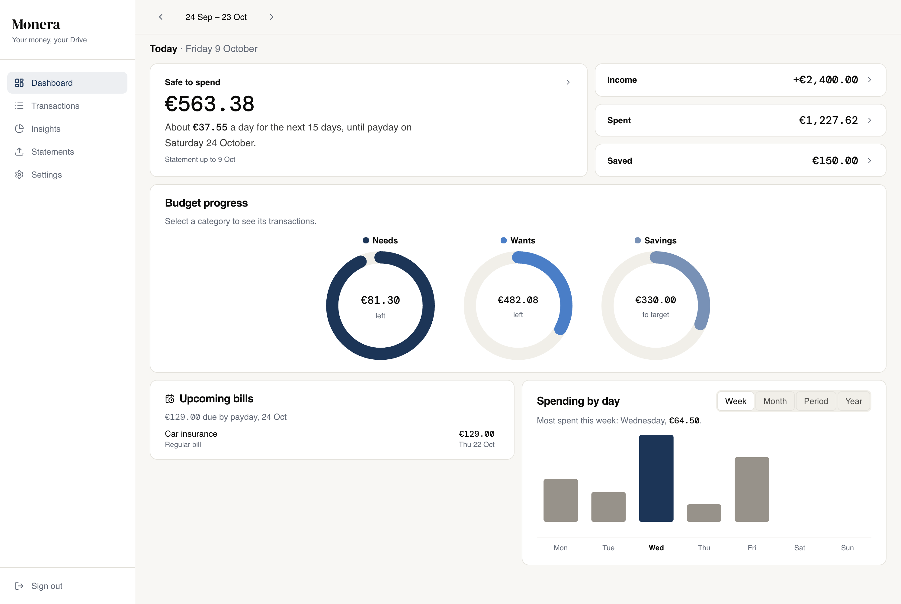

# Monera

> Private budgeting for Revolut users. Your statements live in your own Google Drive — not on anyone else's server.

[](https://www.gnu.org/licenses/agpl-3.0)
[](https://nextjs.org)
[](https://www.typescriptlang.org)

**[Try it free at mymonera.com](https://mymonera.com)** · or [run it yourself](#getting-started)



Export a statement from Revolut, drop it in, and see where your pay went — counted from payday to payday, not by calendar month.

## What you get

- **Safe to spend** — what you can still spend before payday, after bills due and your savings target.
- **Budgets that follow your payday** — Needs, Wants and Savings for each pay period.
- **Every number explained** — tap any figure to see the transactions and the sum behind it.
- **Subscriptions and upcoming bills** — spot regular charges and see what's due before payday.
- **Categories that learn** — fix one transaction and similar ones follow.
- **Your data stays yours** — everything lives in a `Monera/` folder in your Google Drive. Monera can only see files it created, and has no server or database of its own.

<details>
<summary>All features</summary>

| | |
|---|---|
| **Your data, your Drive** | All data lives in a `Monera/` folder you own. The app uses the minimal `drive.file` scope — it can only see files it created. |
| **Payday-aware budgets** | Periods run payday-to-payday (e.g. the 24th), not calendar months. Override income and the needs / wants / savings split per period. |
| **Import CSV or Excel** | Drop in a Revolut `.csv` or `.xlsx` export (up to 25 MB). Excel files are converted in the browser — nothing leaves your machine until it hits Drive. Transactions are dated by when you tapped the card, not when the bank settled. Pending transactions are imported too (settlement can take days) — only declined, failed, or reverted ones are skipped. |
| **Smart categorization** | Keyword rules (case-insensitive, partial-match) auto-categorize transactions. Re-categorizing one transaction applies the same category to similar ones, saves a reusable rule, and offers a one-tap undo. Per-transaction overrides are remembered and always win. |
| **Powerful transaction list** | Separate Expenses, Savings, Income and All lists, so the Expenses total always matches the dashboard's Spent. Multi-column sort, category filter, custom date ranges, and full-text search scoped to the selected period — all persisted across navigation. Export what's on screen as CSV. Keyboard shortcuts: `/` jumps to search, `Esc` clears a selection. Large lists load 50 transactions at a time. |
| **Bulk editing & undo** | Inline checkboxes let you multi-select transactions to exclude, re-categorize, or reset to rule defaults — regular bills included, so a bill can be left out or moved for a single pay period. Every change — leaving out, counting again, moving category, deleting a manual entry — can be undone for a few seconds. |
| **Insights** | **Merchants:** where your money went this period, what you spent (with refunds shown, so the rows add up) and how it compares with last period up to the same day. **Subscriptions:** your regular bills with what each has cost since it started, and detected subscriptions (optional spending charged monthly or every other month at a steady price) at their latest price. **Year:** each pay period of the year with a plain-language summary. Hiding a place or subscription says what it does and doesn't change, offers Undo, and each hidden item can be brought back on its own. |
| **Tappable drill-downs** | Every figure traces to its transactions: tap a dashboard card, a budget circle, or any chart bar to see the exact transactions and the calculation behind it. On phones these open as a bottom sheet; on wider screens as a side panel. |
| **Spending by day** | Which weekdays cost you most, over the pay period (the default), this week, or the year: 7 bars (Mon–Sun) with a one-line takeaway. Statements are exported by hand and end before today, so the chart says where your statement ends instead of showing those days as "no spending". Hovering a bar and tapping into it both show the same Spent / Refunded / Net breakdown, and only transactions that have actually happened are counted. |
| **Year overview** | The Year tab shows each pay period's Needs, Wants and Savings across the year, chosen with the year arrows in the top bar. A one-line summary names your biggest period and how the running one stands, including bills still to come; the running period is striped so its short bar isn't read as a cheap month. Spent and saved totals for the year, and click-through to any period on the dashboard. |
| **Safe to spend** | Forward-looking card that shows what you can still spend before payday — after money spent so far, savings set aside, and bills still due this period. The Needs and Wants circles add up to it exactly. |
| **Budget circles** | One ring per category showing what's left after bills due. Money already spent is a solid arc and bills still to pay are ticks, with a key ("€800.00 due 20 Jun"), so a ring that's mostly rent-to-come never looks like overspending. Over budget turns red and says "over", or "over after bills" when a bill is what tips it. Savings only counts money actually moved, never a transfer that's still scheduled. |
| **Upcoming bills** | Dashboard card listing everything due before payday — recurring bills with exact dates and estimated charges from detected subscriptions. Pin an estimated charge as a bill for an exact date. |
| **One currency** | Amounts are only ever added up in one currency: your main one, from your statements. Transactions in another currency are left out of every total, and the dashboard says how many. |
| **Simple, clear wording** | Every number has a short plain label and nothing more. A replayable guided tour explains each page on first visit. |
| **Accessible** | Full keyboard navigation with visible focus, labelled controls for screen readers, WCAG AA colour contrast, and 44px tap targets on phones. With reduced motion on, nothing moves anywhere: sheets, dialogs, tooltips and loading states included. |
| **Mobile-first account controls** | On mobile, the Settings page shows your Google account name, photo, and a Sign out button at the very top — no scrolling required. Sign-out clears the session, cached transaction data and the browser's offline cache. |
| **Recurring payments** | Track fixed payments paid outside Revolut (rent, insurance, savings transfers, etc). They appear as transactions in every pay period from the one holding your first transaction (before that Monera knows nothing about your money, so it doesn't invent spending), count toward your budget once their date arrives, and can be left out or moved for a single period like any other transaction. Future-dated occurrences stay visible (e.g. in the transaction list, marked as upcoming) without being counted in any total until they've actually happened. Configured under Settings → Bills, with support for any spending category including Savings. A one-time nudge after the first successful import prompts the user to set these up. |
| **Duplicate-safe imports** | Re-uploading the same statement never creates duplicates. Two genuinely identical same-day purchases are both preserved. |
| **Fast & optimistic** | Data is cached in memory (TanStack Query). Edits show immediately and save to Drive one at a time in order; each save applies its change to the copy in Drive, so changes made on another device aren't written over, and a failed save re-reads Drive rather than guessing. Settings and rules reload when you come back to the app. Installable PWA. |
| **Resilient error recovery** | If loading fails, every page says why in plain words — offline, Google sign-in expired, or Drive trouble — with the one action that fixes it ("Try again" or "Sign in again"). An offline banner appears when the connection drops. React error boundaries catch unexpected render errors so the app degrades gracefully rather than going blank. |
| **Multiple income sources** | Salary keywords identify salary-type transactions for display. Configured salary basis (from Settings) and all detected income are always summed — so income from multiple employers and side jobs are counted together. |

</details>

---

## Tech Stack

| Area | Choice |
|---|---|
| Framework | [Next.js 16](https://nextjs.org) (App Router) + React 19 |
| Auth | [NextAuth v5](https://authjs.dev) — Google OAuth, JWT sessions |
| Storage | Google Drive REST API (`drive.file` scope) |
| Data layer | [TanStack Query v5](https://tanstack.com/query) — in-memory cache with optimistic updates |
| Styling | Tailwind CSS v4, shadcn/ui (Radix) |
| Charts | Recharts |
| Spreadsheets | SheetJS (lazy-loaded for `.xlsx` uploads) |
| Testing | Vitest (unit), Playwright (end-to-end) |

---

## Getting Started

### Prerequisites

- Node.js 20+
- A Google Cloud project with an OAuth 2.0 Client ID (Web application type)

### 1 — Configure Google OAuth

In the [Google Cloud Console](https://console.cloud.google.com/):

1. Enable the **Google Drive API**.
2. Set up the **OAuth consent screen** — name it *Monera*, add the `drive.file` scope, and add yourself as a **Test user** while in testing mode.
3. Create an **OAuth 2.0 Client ID** (Web application) and add the redirect URIs:
   - `http://localhost:3000/api/auth/callback/google` (development)
   - `https://your-domain/api/auth/callback/google` (production)

### 2 — Environment variables

Create `.env.local` at the project root:

```bash
GOOGLE_CLIENT_ID=your-client-id
GOOGLE_CLIENT_SECRET=your-client-secret
NEXTAUTH_SECRET=        # openssl rand -base64 32
NEXTAUTH_URL=http://localhost:3000
```

### 3 — Install and run

```bash
npm install
npm run dev
```

Open [http://localhost:3000](http://localhost:3000) and sign in with Google.

> **Note:** The `xlsx` package is fetched from SheetJS's CDN on first install — `npm install` requires network access to `cdn.sheetjs.com`.

---

## Project Structure

```
src/
├── app/
│   ├── (auth)/
│   │   ├── dashboard/
│   │   │   ├── page.tsx         # Dashboard — safe to spend, budget circles, upcoming bills, weekday chart
│   │   │   ├── useDashboardData.ts # Everything the dashboard derives for one pay period
│   │   │   ├── _components/     # Summary cards, budget circles, weekday chart, upcoming bills
│   │   │   └── _sheets/         # Drill-down sheets (income, expenses, savings…)
│   │   ├── insights/
│   │   │   ├── page.tsx         # Insights — tab switcher and shared data
│   │   │   ├── _tabs/           # Merchants, Subscriptions, Year
│   │   │   └── _components/     # Year chart, hidden-items list
│   │   ├── transactions/
│   │   │   ├── page.tsx         # Transaction list — sort, filter, bulk actions
│   │   │   └── _components/     # Rows, add/edit form, filter bar, bulk action bar
│   │   ├── settings/
│   │   │   ├── page.tsx         # Settings tabs
│   │   │   └── _components/     # Basics, period, bills and rules forms
│   │   └── upload/              # CSV / XLSX import
│   ├── login/                   # Sign-in screen
│   └── api/auth/                # NextAuth route handler
├── components/                  # Shared only: ui/ (primitives), layout/, onboarding/
├── contexts/                    # AppDataContext — the one place pages get data from
├── hooks/                       # useDrive, useTransactions, useSettings, useRules, useWriteQueue …
├── lib/
│   ├── periods.ts               # Pay-period maths: keys, bounds, ranges
│   ├── format.ts                # Money, dates and period labels as text
│   ├── categories.ts            # Category colours and classes
│   ├── finance.ts               # Single source of truth for period spend and refund netting
│   ├── budget.ts                # Income, spending and allocations for one pay period
│   ├── recurring.ts             # Regular bills, and the rule for when they start counting
│   ├── insights.ts              # Period comparison, merchants, subscription detection
│   ├── safeToSpend.ts           # Forward-looking "safe to spend" calculation
│   ├── weekday.ts               # Spending-by-weekday chart data
│   ├── statements.ts            # Reading, checking and saving uploaded statements
│   ├── migrateSettings.ts       # Version-aware settings migration (fills missing defaults on load)
│   ├── parser/                  # CSV / XLSX parsing, amounts and dates
│   ├── spreadsheet.ts           # XLSX → CSV conversion
│   └── google/                  # Drive API wrappers and folder helpers
└── types/                       # Shared TypeScript types
```

Components used by one page live next to it, in that page's `_components/`, `_sheets/` or `_tabs/` folder. Only pieces shared across pages live in `src/components/`. Data flows one way: `lib/google` talks to Drive, the hooks cache it and queue saves, `AppDataContext` hands it to pages, and the money logic in `lib/` is plain functions with unit tests.

### Drive folder layout

```
Monera/
├── revolut-exports/     # Uploaded CSV statements
└── app-data/            # settings.json, category-rules.json,
                         # category-overrides.json, manual-transactions.json,
                         # excluded-transactions.json, parse-cache.json
```

---

## Scripts

| Command | What it does |
|---|---|
| `npm run dev` | Start the development server |
| `npm run build` | Production build |
| `npm start` | Serve the production build |
| `npm run lint` | Lint with ESLint |
| `npm test` | Run the unit tests (Vitest) |
| `npm run test:e2e` | Run the end-to-end tests (Playwright) |

---

## Privacy & Security

- **No server-side storage.** Data never leaves your Google Drive. Monera has no backend database.
- **No browser storage of financial data.** Transaction data is kept only in memory during the session. Transaction-list filter preferences are stored in sessionStorage, which clears when the tab closes. The IDs of Monera's own Drive folders and files are kept in localStorage so return visits open faster — IDs only, no financial data. The offline cache holds only the app's own files and public pages, never signed-in screens, and is cleared on sign-out.
- **Minimal OAuth scope.** `drive.file` grants access only to the files Monera creates — it cannot read the rest of your Drive.
- **Persistent sessions.** Google OAuth is configured to always issue a refresh token, so the server renews the 1-hour access token 5 minutes before it expires — users stay signed in without being interrupted.
- **Encrypted, HttpOnly session cookie.** The refresh token never leaves it and is used only by the server. The short-lived access token is also handed to the page in your browser, which uses it to talk to Google Drive directly — so your financial data goes straight between your browser and Google and never passes through Monera's servers. Tokens are never logged.
- **No third-party sharing of personal data.** Authentication and storage are handled entirely by Google. The only other third party is Vercel Analytics, which receives anonymous, aggregated usage metrics (page views, performance) — never your name, email, or financial data.
- **Google API Limited Use.** Monera's use of data received from Google APIs adheres to the [Google API Services User Data Policy](https://developers.google.com/terms/api-services-user-data-policy), including the Limited Use requirements. See the in-app [privacy policy](src/app/privacy/page.tsx) for the full per-data-item disclosure.

---

## Deployment

Monera deploys to [Vercel](https://vercel.com) without any configuration beyond setting environment variables:

1. Import the repository in Vercel.
2. Add the four environment variables from step 2 above.
3. Add your production callback URL (`https://your-domain/api/auth/callback/google`) to the Google OAuth client.

The app builds with `next build` and runs as a standard serverless Next.js application.

---

## Testing

```bash
npm test            # unit tests
npm run test:e2e    # end-to-end tests in a real browser
```

The unit tests cover the financial logic that matters most: refund netting and dashboard/reports consistency, payday-aware period math, CSV/XLSX parsing, deduplication, categorization, income reconciliation (including salary keyword and multi-employer scenarios), subscription detection, when regular bills start counting, upcoming charge estimation, Drive pagination, plain-language load-error messages, and settings migration.

The end-to-end tests (`tests/e2e/`) drive a production build through every screen: first-run setup, the dashboard and its drill-downs, transactions (search, filters, category changes, leave out, undo, add/edit/delete, CSV export), Insights, statement upload (CSV and Excel), every Settings tab, sign-out, expired sessions, Drive outages, offline mode, and the phone layout. They need no Google account: sign-in uses a session cookie signed with a test secret, and Google Drive is replaced by an in-memory fake inside the browser (`tests/e2e/support/fakeDrive.ts`). The clock is fixed at 15 June 2026 so every figure is predictable. The first run needs the browsers installed: `npx playwright install chromium`.

---

## License

Licensed under the [GNU Affero General Public License v3.0](LICENSE).
